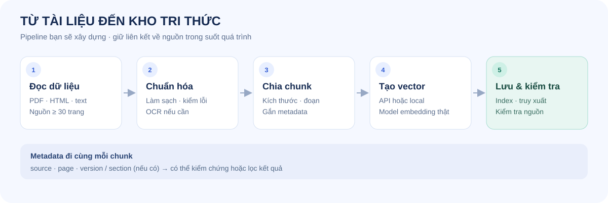
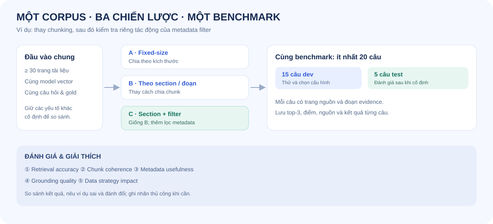

# Day 06 · Data Ingestion Engineering

## Trạng thái bài làm Luật Đất đai

Xem [checkpoint](CHECKPOINTS.md) và mục “Ghi chú xác nhận và trạng thái nộp bài” ở đầu [báo cáo cá nhân](report/individual/2A202603624_DamTuanLinh.md). Snapshot mã/kết quả đã commit và push: [f3a1470](https://github.com/damlinh820/K5-L3A-DAY06-2A202603624-DataIngestion/commit/f3a1470c357e144a97248ae7a9023a3113562faf). Gate 1–3 đã xác nhận; audit là nhãn AI, chưa ghi nhận cụ thể các dòng học viên xác minh. Việc nộp link qua kênh lớp do học viên tự xác nhận.

Corpus hiện tại là ba PDF `data/luatdat1.pdf` đến `data/luatdat3.pdf`; [manifest](data/manifest.json) ghi nguồn Chính phủ và 253 trang có văn bản. Học viên đã xác nhận corpus ở Gate 1. Dùng môi trường `.venv-legal`, OpenRouter `openai/text-embedding-3-small` (1536 chiều), Chroma persistent cosine. Các bước cũ trong `starter/` là implementation trước đây cho corpus Đà Lạt, chưa phải pipeline chunk pháp lý A/B/C mới.

Gate 2 và Gate 3 đã được xác nhận; [20 câu benchmark](benchmark/REVIEW.md) đã khóa và commit tại `65922c5` trước retrieval. Ba cấu hình A/B/C đã ingest bằng embedding thật, nạp lại không nhân đôi. Dev chọn C trước test; xem [dev_selection.json](results/dev_selection.json), [test_run.json](results/test_run.json), [metrics.csv](results/metrics.csv). C đạt Evidence Hit@3 13/15 dev và 4/5 test. Theo yêu cầu mới của học viên, Codex đã chấm đủ 30/45/15 dòng audit: [kết quả dễ đọc](results/AUDIT_REVIEW.md), [phương pháp](results/audit_method.json). Đây là **nhãn AI, chưa có xác minh của học viên**, không phải nhãn thủ công độc lập.

Từ bản clone mới, dùng Python 3.12 và chạy tại thư mục gốc; không cần kích hoạt PowerShell script:

```powershell
python -m venv .venv-legal
.\.venv-legal\Scripts\python.exe -m pip install -r requirements.lock.txt
.\.venv-legal\Scripts\python.exe scripts/verify_evidence.py
.\.venv-legal\Scripts\python.exe -m unittest discover -s tests -v
.\.venv-legal\Scripts\python.exe scripts/check_phase4_integrity.py
.\.venv-legal\Scripts\python.exe scripts/summarize_manual_audits.py --check-only
.\.venv-legal\Scripts\python.exe scripts/check_submission.py
```

Các lệnh kiểm tra trên dùng snapshot/trace đã nộp, không gọi embedding hay chạy lại retrieval. Lần đầu tokenizer `cl100k_base` có thể cần mạng tải dữ liệu. Chỉ tạo venv khi chưa có; môi trường hiện có không cần tạo lại. Trên máy khác có Python 3.12, có thể dùng `py -3.12 -m venv .venv-legal`.

PDF gốc, cache vector và Chroma không đưa vào Git. Tải ba PDF qua các URL trong [manifest](data/manifest.json), đặt lần lượt tại `data/luatdat1.pdf`, `luatdat2.pdf`, `luatdat3.pdf` và kiểm tra SHA-256 so với manifest trước khi dùng. Manifest ghi hash bản học viên cung cấp; chưa khẳng định bản tải mới từ cổng có hash giống hệt. `results/pages.jsonl`, `chunks_A/B/C.jsonl`, trace và log đã kèm theo để đối chiếu số liệu. `check_phase3_results.py` chỉ chạy khi có index/cache tại máy đã thực nghiệm; không áp dụng cho bản clone chưa có Chroma. Không gỡ khóa rồi ghi đè thí nghiệm hiện tại để chạy lại; một thí nghiệm mới phải có thư mục kết quả và hồ sơ riêng.

`requirements.lock.txt` lưu phiên bản môi trường đã cài. API key tiếp tục được đọc từ `.env` hoặc `starter/.env`; không đưa key vào Git/chat. `prepare_legal_corpus.py` chỉ dùng để tạo snapshot ban đầu và từ chối chạy lại sau khi benchmark được khóa, để tránh đổi corpus ngoài ý muốn. Xem [protocol](benchmark/protocol.json) về split, tiêu chí chọn dev và cách giữ test.

Lệnh đã dùng cho Phase 3, từ thư mục gốc (snapshot đã duyệt hiện được bảo vệ; không rebuild/re-ingest để đổi thí nghiệm):

```powershell
.\.venv-legal\Scripts\python.exe scripts/build_legal_chunks.py
.\.venv-legal\Scripts\python.exe -m src.ingest --config all --verify-reingest
.\.venv-legal\Scripts\python.exe scripts/check_phase3_results.py
.\.venv-legal\Scripts\python.exe scripts/prepare_chunk_review.py
```

Index bền vững nằm tại `results/chroma/`, collection `land_law_a`, `land_law_b`, `land_law_c`, cosine HNSW. Cache `results/embedding_cache.jsonl` chỉ chứa vector từ response API thật, không phải fallback; cache và index được Git ignore. Dev/test đã chạy theo thứ tự dưới đây; evaluator từ chối chạy lại để chọn điểm đẹp hơn hoặc thay cấu hình sau khi xem test:

```powershell
.\.venv-legal\Scripts\python.exe -m src.evaluate --split dev
.\.venv-legal\Scripts\python.exe -m src.evaluate --split test
.\.venv-legal\Scripts\python.exe scripts/prepare_retrieval_audits.py
```

Kiểm tra tính nhất quán của trace đã lưu mà không chạy lại retrieval:

```powershell
.\.venv-legal\Scripts\python.exe scripts/check_phase4_integrity.py
.\.venv-legal\Scripts\python.exe scripts/summarize_manual_audits.py --check-only
```

Ba bảng `results/audit_coherence.csv`, `audit_metadata.csv`, `audit_grounding.csv` đã có điểm và lý do do AI chấm theo yêu cầu học viên; nguồn gốc được ghi trên từng dòng. Chạy `scripts/summarize_manual_audits.py` để kiểm tra và tổng hợp `results/audit_summary.json`; script không suy điểm từ Hit@3. Hướng dẫn xem xét nhãn ở [Gate 4](results/AUDIT_GUIDE.md). Bản báo cáo ở [report/individual/2A202603624_DamTuanLinh.md](report/individual/2A202603624_DamTuanLinh.md); [đối chiếu checklist nộp bài](results/SUBMISSION_REVIEW.md).

**Lab cá nhân** · **4 giờ** · **Dữ liệu tự chọn**

Biến tài liệu thành kho tri thức có thể truy xuất cho AI agent, rồi đo xem cách chuẩn bị dữ liệu nào hiệu quả nhất.

| 📄 Dữ liệu | 🧩 Chiến lược | 🎯 Benchmark |
|---|---|---|
| Tối thiểu **30 trang nội dung** | Tối thiểu **3 cấu hình** | Tối thiểu **20 câu hỏi** |

## Bắt đầu nhanh

Dùng [starter PostgreSQL + pgvector](starter/README.md) để dựng database và chạy pipeline khung, hoặc tự chọn vector store tương đương. Bạn vẫn cần chuẩn bị corpus/manifest, tự viết và xác minh benchmark gold, rồi chạy thí nghiệm và audit thủ công.

## 1. Xây pipeline



Chọn tài liệu được phép sử dụng; giữ **ID tài liệu, nguồn, trang/vị trí** và metadata phù hợp. Dùng embedding model thật qua API hoặc chạy local; lưu và truy xuất bằng pgvector, Qdrant, Chroma hoặc một store tương đương.

## 2. So sánh và đánh giá



Dùng cùng dữ liệu, model và câu hỏi cho cả ba cấu hình. Tách **15 câu dev / 5 câu test** trước khi chạy; chọn cấu hình trên dev, rồi đánh giá test sau khi cố định. Mỗi câu hỏi cần có đoạn bằng chứng và trang nguồn; thiết kế bộ câu hỏi và đánh giá theo [BENCHMARK.md](BENCHMARK.md).

Đánh giá theo năm khía cạnh: **độ chính xác truy xuất**, **tính mạch lạc của chunk**, **tính hữu dụng của metadata**, **chất lượng grounding** và **tác động của chiến lược dữ liệu**. Giải thích lựa chọn bằng kết quả, ví dụ lỗi và các đánh đổi.

## 3. Chuẩn bị bài nộp

1. Chạy pipeline và lưu cấu hình, kết quả top-3, trace cùng nhãn đánh giá thủ công.
2. Điền [thông tin học viên](STUDENT.md), [nhật ký thí nghiệm](artifacts/experiment_log.csv) và bản sao [mẫu báo cáo cá nhân](report/individual/MSSV_HoTen.md).
3. Kiểm tra mã nguồn, cách chạy, manifest dữ liệu và checklist trong [SUBMISSION.md](SUBMISSION.md).

## Tài liệu hướng dẫn

| Bạn cần tìm | Tài liệu |
|---|---|
| Setup baseline PostgreSQL + pgvector | [starter/README.md](starter/README.md) |
| Các bước làm và cách tính chỉ số | [GUIDE.md](GUIDE.md) |
| Tiến độ trong 4 giờ | [CHECKPOINTS.md](CHECKPOINTS.md) |
| Năm tiêu chí benchmark và bộ câu hỏi | [BENCHMARK.md](BENCHMARK.md) |
| Tiêu chí chấm điểm | [RUBRIC.md](RUBRIC.md) |
| Quy tắc sử dụng dữ liệu, AI và API | [RULES.md](RULES.md) |
| Cách nộp bài | [SUBMISSION.md](SUBMISSION.md) |

[data/format-example.json](data/format-example.json) chỉ minh họa định dạng, không phải corpus đủ điều kiện. Câu hỏi benchmark, nhãn gold, thí nghiệm và audit phải do bạn chuẩn bị/kiểm chứng; không bắt buộc xây chatbot.
